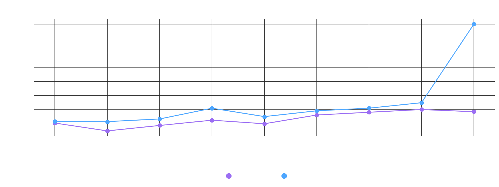
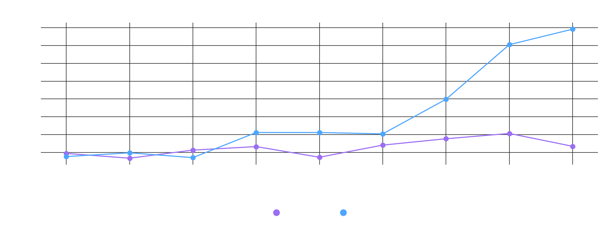
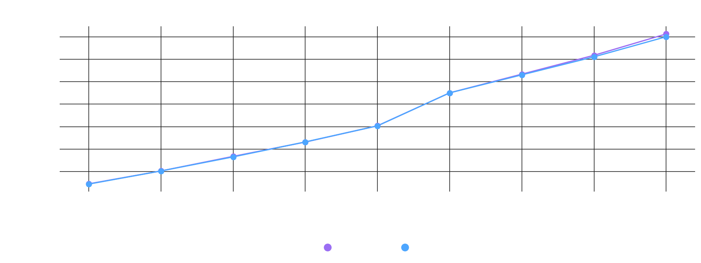
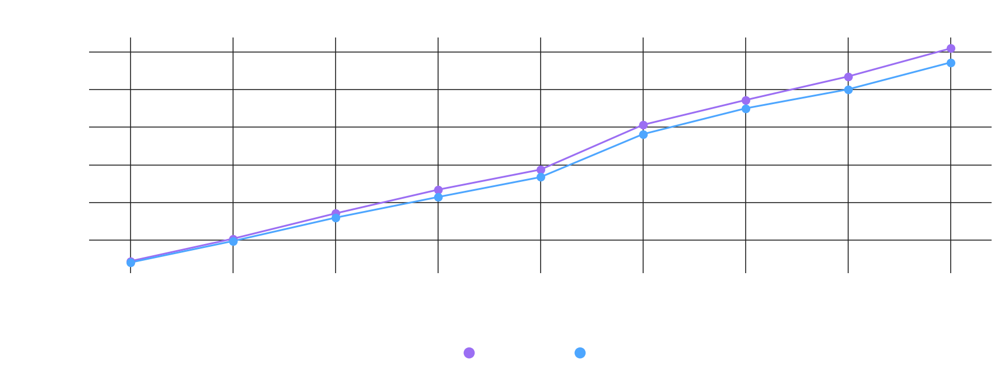
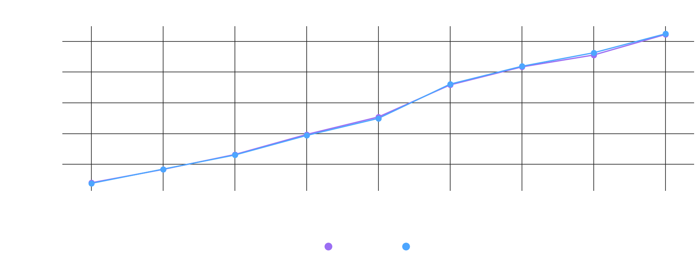
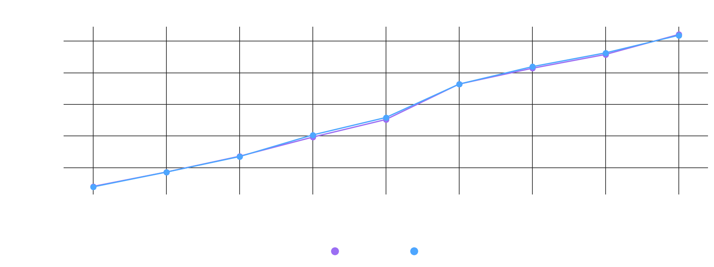
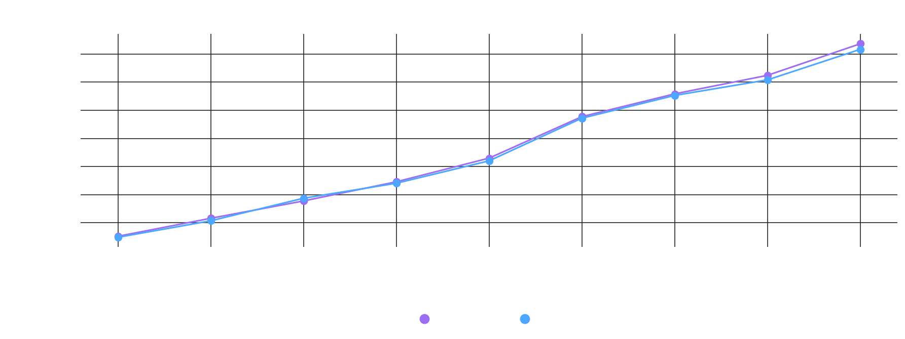
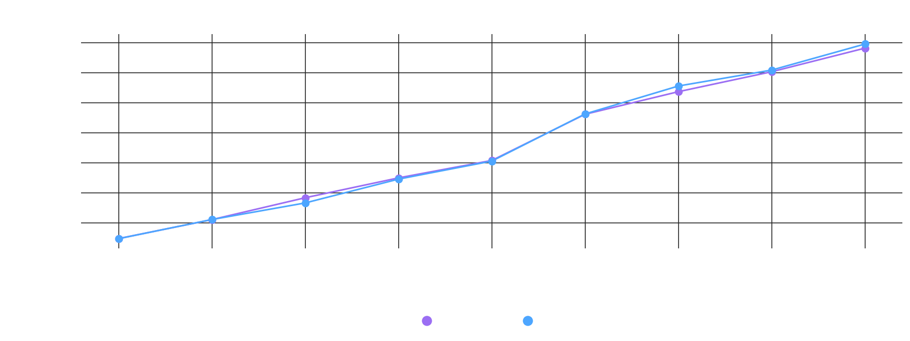
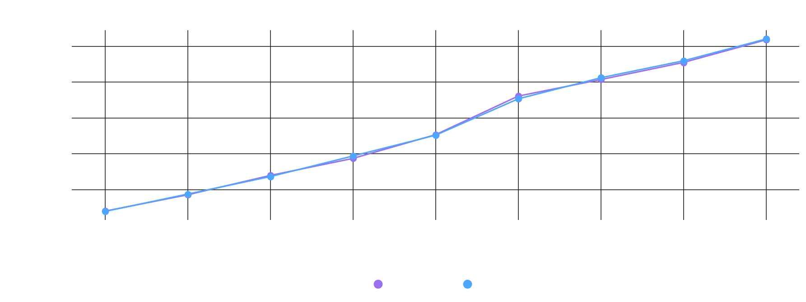

# Custom TreeMap

An implementation of a Java TreeMap using a Red-Black Tree.

All methods implemented are identical to those found in the Java NavigableMap interface.

# Build and Test

To build and test the project run command `./gradlew clean build`

To test the project run command `./gradlew test`

### Time Complexity

| Method                             |    Custom     |      JDK      | Winner  |
|:-----------------------------------|:-------------:|:-------------:|:-------:|
| **CustomTreeMap()**                |    $O(1)$     |    $O(1)$     |   Tie   |
| **CustomTreeMap(Comparator)**      |    $O(1)$     |    $O(1)$     |   Tie   |
| **CustomTreeMap(Map)**             | $O(m \log n)$ | $O(m \log n)$ |   Tie   |
| **CustomTreeMap(SortedMap)**       | $O(m \log n)$ |    $O(m)$     | **JDK** |
| **ceilingEntry(K)**                |  $O(\log n)$  |  $O(\log n)$  |   Tie   |
| **ceilingKey(K)**                  |  $O(\log n)$  |  $O(\log n)$  |   Tie   |
| **clear()**                        |    $O(1)$     |    $O(1)$     |   Tie   |
| **comparator()**                   |    $O(1)$     |    $O(1)$     |   Tie   |
| **containsKey(Object)**            |  $O(\log n)$  |  $O(\log n)$  |   Tie   |
| **descendingKeySet()**             |    $O(1)$     |    $O(1)$     |   Tie   |
| **descendingMap()**                |    $O(1)$     |    $O(1)$     |   Tie   |
| **entrySet()**                     |    $O(1)$     |    $O(1)$     |   Tie   |
| **firstEntry()**                   |  $O(\log n)$  |  $O(\log n)$  |   Tie   |
| **firstKey()**                     |  $O(\log n)$  |  $O(\log n)$  |   Tie   |
| **floorEntry(K)**                  |  $O(\log n)$  |  $O(\log n)$  |   Tie   |
| **floorKey(K)**                    |  $O(\log n)$  |  $O(\log n)$  |   Tie   |
| **get(Object)**                    |  $O(\log n)$  |  $O(\log n)$  |   Tie   |
| **headMap(K)**                     |    $O(1)$     |    $O(1)$     |   Tie   |
| **headMap(K, boolean)**            |    $O(1)$     |    $O(1)$     |   Tie   |
| **higherEntry(K)**                 |  $O(\log n)$  |  $O(\log n)$  |   Tie   |
| **higherKey(K)**                   |  $O(\log n)$  |  $O(\log n)$  |   Tie   |
| **lastEntry()**                    |  $O(\log n)$  |  $O(\log n)$  |   Tie   |
| **lastKey()**                      |  $O(\log n)$  |  $O(\log n)$  |   Tie   |
| **lowerEntry(K)**                  |  $O(\log n)$  |  $O(\log n)$  |   Tie   |
| **lowerKey(K)**                    |  $O(\log n)$  |  $O(\log n)$  |   Tie   |
| **navigableKeySet()**              |    $O(1)$     |    $O(1)$     |   Tie   |
| **pollFirstEntry()**               |  $O(\log n)$  |  $O(\log n)$  |   Tie   |
| **pollLastEntry()**                |  $O(\log n)$  |  $O(\log n)$  |   Tie   |
| **put(K, V)**                      |  $O(\log n)$  |  $O(\log n)$  |   Tie   |
| **remove(Object)**                 |  $O(\log n)$  |  $O(\log n)$  |   Tie   |
| **size()**                         |    $O(1)$     |    $O(1)$     |   Tie   |
| **subMap(K, K)**                   |    $O(1)$     |    $O(1)$     |   Tie   |
| **subMap(K, boolean, K, boolean)** |    $O(1)$     |    $O(1)$     |   Tie   |
| **tailMap(K)**                     |    $O(1)$     |    $O(1)$     |   Tie   |
| **tailMap(K, boolean)**            |    $O(1)$     |    $O(1)$     |   Tie   |

### Space Complexity

| Method                             | Custom |  JDK   | Winner |
|:-----------------------------------|:------:|:------:|:------:|
| **CustomTreeMap()**                | $O(1)$ | $O(1)$ |  Tie   |
| **CustomTreeMap(Comparator)**      | $O(1)$ | $O(1)$ |  Tie   |
| **CustomTreeMap(Map)**             | $O(1)$ | $O(1)$ |  Tie   |
| **CustomTreeMap(SortedMap)**       | $O(1)$ | $O(1)$ |  Tie   |
| **ceilingEntry(K)**                | $O(1)$ | $O(1)$ |  Tie   |
| **ceilingKey(K)**                  | $O(1)$ | $O(1)$ |  Tie   |
| **clear()**                        | $O(1)$ | $O(1)$ |  Tie   |
| **comparator()**                   | $O(1)$ | $O(1)$ |  Tie   |
| **containsKey(Object)**            | $O(1)$ | $O(1)$ |  Tie   |
| **descendingKeySet()**             | $O(1)$ | $O(1)$ |  Tie   |
| **descendingMap()**                | $O(1)$ | $O(1)$ |  Tie   |
| **entrySet()**                     | $O(1)$ | $O(1)$ |  Tie   |
| **firstEntry()**                   | $O(1)$ | $O(1)$ |  Tie   |
| **firstKey()**                     | $O(1)$ | $O(1)$ |  Tie   |
| **floorEntry(K)**                  | $O(1)$ | $O(1)$ |  Tie   |
| **floorKey(K)**                    | $O(1)$ | $O(1)$ |  Tie   |
| **get(Object)**                    | $O(1)$ | $O(1)$ |  Tie   |
| **headMap(K)**                     | $O(1)$ | $O(1)$ |  Tie   |
| **headMap(K, boolean)**            | $O(1)$ | $O(1)$ |  Tie   |
| **higherEntry(K)**                 | $O(1)$ | $O(1)$ |  Tie   |
| **higherKey(K)**                   | $O(1)$ | $O(1)$ |  Tie   |
| **lastEntry()**                    | $O(1)$ | $O(1)$ |  Tie   |
| **lastKey()**                      | $O(1)$ | $O(1)$ |  Tie   |
| **lowerEntry(K)**                  | $O(1)$ | $O(1)$ |  Tie   |
| **lowerKey(K)**                    | $O(1)$ | $O(1)$ |  Tie   |
| **navigableKeySet()**              | $O(1)$ | $O(1)$ |  Tie   |
| **pollFirstEntry()**               | $O(1)$ | $O(1)$ |  Tie   |
| **pollLastEntry()**                | $O(1)$ | $O(1)$ |  Tie   |
| **put(K, V)**                      | $O(1)$ | $O(1)$ |  Tie   |
| **remove(Object)**                 | $O(1)$ | $O(1)$ |  Tie   |
| **size()**                         | $O(1)$ | $O(1)$ |  Tie   |
| **subMap(K, K)**                   | $O(1)$ | $O(1)$ |  Tie   |
| **subMap(K, boolean, K, boolean)** | $O(1)$ | $O(1)$ |  Tie   |
| **tailMap(K)**                     | $O(1)$ | $O(1)$ |  Tie   |
| **tailMap(K, boolean)**            | $O(1)$ | $O(1)$ |  Tie   |

# Performance Comparison

Geometric mean (ns/op) across all tested collection sizes (10,000-100,000 elements). Margins under 1.10x are treated as noise-level ties since the source data has no per-run error/variance to test true statistical significance.

| Method                                                                   | Custom (ns) | JDK (ns)    | Margin |            Winner            |
|:-------------------------------------------------------------------------|:------------|:------------|:------:|:----------------------------:|
| `Constructor()`                                                          | 2.0         | 2.0         | 1.00x  | **Statistically Equivalent** |
| `Constructor(Comparator<? super K> comparator)`                          | 2.0         | 2.0         | 1.00x  | **Statistically Equivalent** |
| `Constructor(Map<? extends K, ? extends V> m)`                           | 8,798,339.4 | 8,727,063.2 | 0.99x  | **Statistically Equivalent** |
| `Constructor(SortedMap<K, ? V extends> m)`                               | 636,274.6   | 596,410.1   | 0.94x  | **Statistically Equivalent** |
| `ceilingEntry(K key)`                                                    | 124.9       | 124.8       | 1.00x  | **Statistically Equivalent** |
| `ceilingKey(K key)`                                                      | 123.9       | 124.8       | 1.01x  | **Statistically Equivalent** |
| `clear()`                                                                | 1.0         | 2.0         | 2.00x  | **Statistically Equivalent** |
| `comparator()`                                                           | 1.0         | 1.0         | 1.00x  | **Statistically Equivalent** |
| `containsKey(Object key)`                                                | 123.9       | 124.4       | 1.00x  | **Statistically Equivalent** |
| `containsValue(Object value)`                                            | 275,459.8   | 270,584.3   | 0.98x  | **Statistically Equivalent** |
| `descendingKeySet()`                                                     | 1.0         | 1.0         | 1.00x  | **Statistically Equivalent** |
| `descendingKeySet().iterator()`                                          | 749,422.3   | 734,067.4   | 0.98x  | **Statistically Equivalent** |
| `descendingMap()`                                                        | 1.0         | 1.0         | 1.00x  | **Statistically Equivalent** |
| `descendingMap().entrySet().iterator()`                                  | 564,605.9   | 571,516.9   | 1.01x  | **Statistically Equivalent** |
| `entrySet()`                                                             | 1.0         | 1.0         | 1.00x  | **Statistically Equivalent** |
| `entrySet().iterator()`                                                  | 529,135.1   | 537,478.0   | 1.02x  | **Statistically Equivalent** |
| `firstEntry()`                                                           | 10.4        | 10.3        | 0.99x  | **Statistically Equivalent** |
| `firstKey()`                                                             | 10.0        | 9.3         | 0.93x  | **Statistically Equivalent** |
| `floorEntry(K key)`                                                      | 124.3       | 123.6       | 0.99x  | **Statistically Equivalent** |
| `floorKey(K key)`                                                        | 124.4       | 124.9       | 1.00x  | **Statistically Equivalent** |
| `get(Object key)`                                                        | 124.1       | 124.0       | 1.00x  | **Statistically Equivalent** |
| `headMap(K toKey)`                                                       | 3.0         | 3.0         | 1.00x  | **Statistically Equivalent** |
| `headMap(K toKey).entrySet().iterator()`                                 | 273,277.7   | 273,666.7   | 1.00x  | **Statistically Equivalent** |
| `headMap(K toKey, boolean inclusive)`                                    | 3.0         | 3.0         | 1.00x  | **Statistically Equivalent** |
| `higherEntry(K key)`                                                     | 95.0        | 131.8       | 1.39x  |          **Custom**          |
| `higherKey(K key)`                                                       | 94.0        | 133.8       | 1.42x  |          **Custom**          |
| `isEmpty()`                                                              | 1.0         | 1.0         | 1.00x  | **Statistically Equivalent** |
| `keySet()`                                                               | 1.0         | 1.0         | 1.00x  | **Statistically Equivalent** |
| `keySet().iterator()`                                                    | 557,607.0   | 531,615.7   | 0.95x  | **Statistically Equivalent** |
| `lastEntry()`                                                            | 10.6        | 10.6        | 1.00x  | **Statistically Equivalent** |
| `lastKey()`                                                              | 10.4        | 9.6         | 0.91x  | **Statistically Equivalent** |
| `lowerEntry(K key)`                                                      | 133.7       | 129.4       | 0.97x  | **Statistically Equivalent** |
| `lowerKey(K key)`                                                        | 133.4       | 129.3       | 0.97x  | **Statistically Equivalent** |
| `navigableKeySet()`                                                      | 1.0         | 1.0         | 1.00x  | **Statistically Equivalent** |
| `navigableKeySet().descendingIterator()`                                 | 561,087.3   | 543,528.0   | 0.97x  | **Statistically Equivalent** |
| `navigableKeySet().iterator()`                                           | 560,871.7   | 540,691.8   | 0.96x  | **Statistically Equivalent** |
| `pollFirstEntry()`                                                       | 1.0         | 1.0         | 1.00x  | **Statistically Equivalent** |
| `pollLastEntry()`                                                        | 1.0         | 1.0         | 1.00x  | **Statistically Equivalent** |
| `put(K key, V value)`                                                    | 128.4       | 127.7       | 0.99x  | **Statistically Equivalent** |
| `putAll(Map<? extends K, ? extends V> m)`                                | 8,769,377.6 | 8,719,015.3 | 0.99x  | **Statistically Equivalent** |
| `remove(Object key)`                                                     | 2.0         | 2.9         | 1.44x  | **Statistically Equivalent** |
| `size()`                                                                 | 1.0         | 1.0         | 1.00x  | **Statistically Equivalent** |
| `subMap(K fromKey, K toKey)`                                             | 4.0         | 3.0         | 0.75x  | **Statistically Equivalent** |
| `subMap(K fromKey, K toKey).entrySet().iterator()`                       | 274,273.9   | 276,270.6   | 1.01x  | **Statistically Equivalent** |
| `subMap(K fromKey, K toKey).keySet().iterator()`                         | 368,639.8   | 361,428.8   | 0.98x  | **Statistically Equivalent** |
| `subMap(K fromKey, K toKey).values().iterator()`                         | 353,644.9   | 355,371.9   | 1.00x  | **Statistically Equivalent** |
| `subMap(K fromKey, boolean fromInclusive, K toKey, boolean toInclusive)` | 4.0         | 3.0         | 0.75x  | **Statistically Equivalent** |
| `tailMap(K fromKey)`                                                     | 3.0         | 3.0         | 1.00x  | **Statistically Equivalent** |
| `tailMap(K fromKey).entrySet().iterator()`                               | 271,937.9   | 272,774.4   | 1.00x  | **Statistically Equivalent** |
| `tailMap(K fromKey, boolean inclusive)`                                  | 3.0         | 3.0         | 1.00x  | **Statistically Equivalent** |
| `values()`                                                               | 1.0         | 1.0         | 1.00x  | **Statistically Equivalent** |
| `values().iterator()`                                                    | 713,708.8   | 538,075.9   | 0.75x  |           **JDK**            |

# Performance Charts

#### Note: The following performance charts are designed to be viewed in dark mode.

